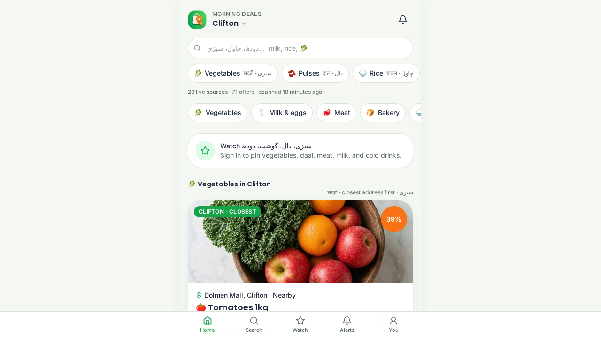

# My Offers

Every deal. Everywhere. Just for you.

My Offers is a neighbourhood price book for the shop you actually use. It puts sabzi, milk, meat, rice, and pantry staples next to the stores on your street, in local currency, and lets you watch the few items you buy every week.

Pick a city or lock GPS. The home screen keeps you inside a radius, ranks neighbourhood chains ahead of big-box shelves, and labels where a price came from.



## What you can do

- Browse today’s prices for vegetables, milk and eggs, meat, bakery, rice and daal, frozen food, drinks, snacks, and household goods.
- Search the way you ask at the counter — tomato or tamatar, milk or doodh — and filter by distance.
- Save a priority list and get an alert when a matching offer lands in a pinned neighbourhood.
- Open a deal, see the store and the source, and share it.
- Submit a price you saw in person. A review queue clears what the community sends in.
- Step off the grocery run when you want to: free AI tools, vacations, and air tickets sit in a separate For you lane.

A chain shelf can sit above a notified mandi rate. The card says which source you are looking at, including store sites, flyers, and community submissions.

## Where it looks

| City | Neighbourhoods in the catalogue |
| --- | --- |
| Karachi | Clifton, DHA, Gulshan-e-Iqbal, North Nazimabad |
| Lahore | DHA, Gulberg, Johar Town |
| Islamabad | F-10, F-7 Blue Area |
| Dubai | Marina, Jumeirah, Deira, Downtown, Al Nahda, Muhaisnah |
| Sharjah | Al Nahda, Al Qasimia |
| Ajman | Al Jerf, Al Bustan |
| London | Westminster, Camden, Greenwich |
| New York | Manhattan, Brooklyn, Queens |

Karachi staples can follow the notified sabzi list. Gulf neighbourhoods lean on the chains families already use — Talal, Madina, Faaz, Day to Day, Imtiaz, and the shops beside them.

## Screens

| Screen | What it is for |
| --- | --- |
| Home | Area, radius, category lanes, and the stores closest to you |
| Search | One item, with filters and distance |
| Offer | Price, store, source, and share |
| Priorities | The weekly list you want watched |
| Alerts | Matches for that list and for pinned neighbourhoods |
| Submit and Review | Add a price, then clear the queue |
| Profile | Sign in, notifications, and saved places |

Sign in is optional until you want priorities and alerts kept on your account.

## Run it locally

Node.js 20 or newer.

```bash
npm install
npm run dev
```

The dev server listens on port 8080.

| Command | What it does |
| --- | --- |
| `npm run dev` | Start the app |
| `npm run build` | Production build and database migrate |
| `npm test` | Project checks |
| `npm run typecheck` | TypeScript |
| `npm run lint` | ESLint |

## Stack

React and TanStack Start, Vite, Tailwind CSS, TanStack Query, Better Auth, and PGlite. Offers are loaded by area, radius, and category. The browser does not scrape stores itself.

## This site

[My Offers on GitHub Pages](https://tajoor621.github.io/MyApp/) is the project home, published from the `main` branch. It is the introduction you are reading. The shopper app runs from the commands above; GitHub Pages does not host that server.
